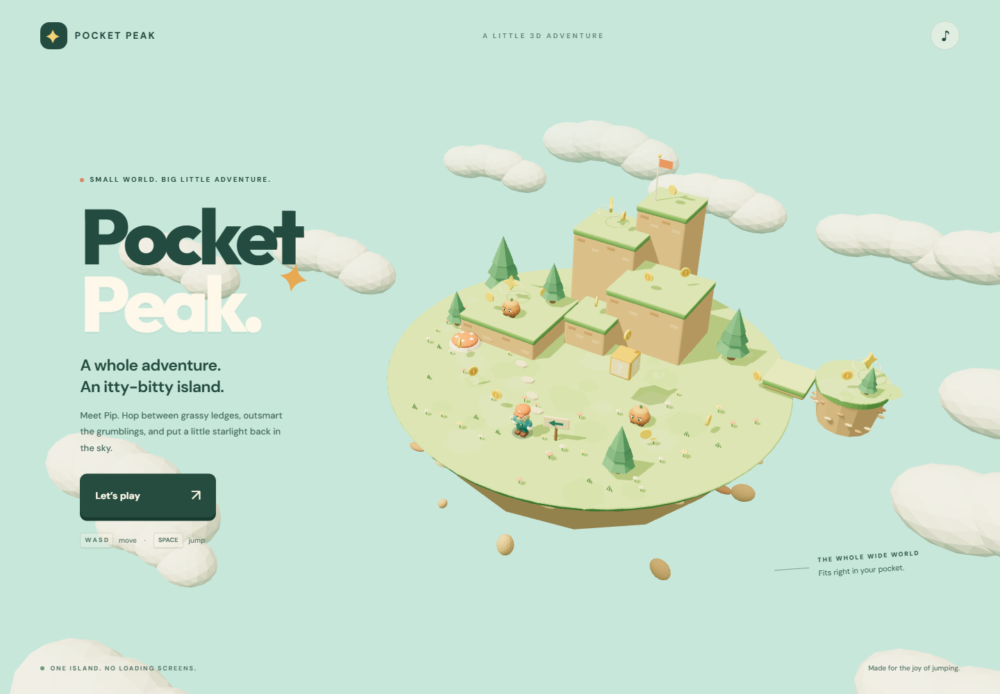

# Pocket Peak ✦

**One tiny island. One big little adventure.**

An original, browser-playable 3D platformer inspired by the joy of classic Mario collectathons. Meet Pip, explore a floating pocket-sized world, find three star fragments, and climb to the summit to claim the star. A complete run takes a few minutes; collecting all 15 coins is an extra challenge.

**[Play Pocket Peak](https://mattias800.github.io/pocket-peak/)**



## Play

No account, download, or installation needed. Use a recent browser with WebGL 2 enabled. Desktop, phone, tablet, and standard gamepads are supported. Sound starts after pressing Play; the music button or **M** toggles it.

| Action               | Keyboard                                        | Gamepad                |
| -------------------- | ----------------------------------------------- | ---------------------- |
| Move                 | WASD / arrow keys                               | Left stick             |
| Jump / double jump   | Space; hold for height, release and press again | A / bottom face button |
| Run                  | Shift                                           | X / left face button   |
| Orbit camera         | Q / E, or drag the scene                        | Right stick            |
| Zoom                 | Mouse wheel                                     | —                      |
| Return to checkpoint | R                                               | —                      |
| Pause                | Escape / pause button                           | Start / Menu           |
| Sound                | M / music button                                | —                      |

On touchscreens, use the joystick and jump button. Push the joystick to the edge to run. Stomp the little grumblings, bounce off the spotted spring mushroom, and try hitting the question block from underneath. Falls preserve your collectibles. The upper fragment activates a checkpoint. After winning, you can keep exploring or start again; your best completion time is saved on your device when storage is available.

## Develop

Requires **Node.js 22.12+** (Node 24 is used in CI) and npm.

```sh
npm ci
npm run dev
```

Open the local address printed by Vite. For a production build:

```sh
npm run build
npm run preview
```

`dist/` is a static site. Relative asset paths allow it to work on GitHub Pages, a subdirectory, or any static web host.

## Project structure

The game uses **TypeScript**, **Three.js**, **Vite**, and a deliberately small kinematic controller. There is no backend, asset pipeline, or large game engine to learn.

| File             | Responsibility                                                             |
| ---------------- | -------------------------------------------------------------------------- |
| `src/level.ts`   | Platform geometry, spawn, collectibles, enemies, and moving-platform paths |
| `src/physics.ts` | Fixed-step movement, collision, variable jumps, double jumps, coyote time  |
| `src/visuals.ts` | Procedural models, materials, lighting, scenery, character animation       |
| `src/game.ts`    | Game state, camera, interactions, progression, particles, main loop        |
| `src/input.ts`   | Keyboard, mouse, touch, and gamepad input                                  |
| `src/audio.ts`   | Original synthesized effects and a small pentatonic music loop             |
| `src/ui.ts`      | Menus, HUD, notifications, and completion records                          |

The physics controller runs at **120 Hz**, independent of rendering. The player's position is the bottom-center of its collision body, and platform `y` coordinates describe their top surfaces. Rendering and input stay outside the physics module, so movement can be tested without a browser. To expand the world, start with the level data and its matching visuals. Trees, flowers, signs, and scenery are decorative; the authored platforms define collision.

## Tests

```sh
npm test                          # Movement, collisions, and staircase reachability
npx playwright install chromium  # First time only
npm run test:e2e                  # Real browser, desktop + touch, full completion route
```

Browser tests drive normal controls and use a read-only snapshot for assertions. They cover actual WebGL rendering, jumping, pause/resume, rescue, touch input, collecting every fragment, winning, and restarting. QA screenshots are written to the ignored `test-results/` directory.

The GitHub Actions workflow runs tests and builds, then publishes `dist/` to GitHub Pages on pushes to `main`. Enable **Settings → Pages → Source → GitHub Actions** if setting this up in a fork.

## Credits and license

Game code, models, world, music, and effects are original and released under the [MIT license](LICENSE). No Nintendo assets, characters, music, or branding are included. Three.js and the other dependencies retain their respective licenses. Fonts are DM Sans and Outfit, distributed under the SIL Open Font License; see `public/fonts/`.
